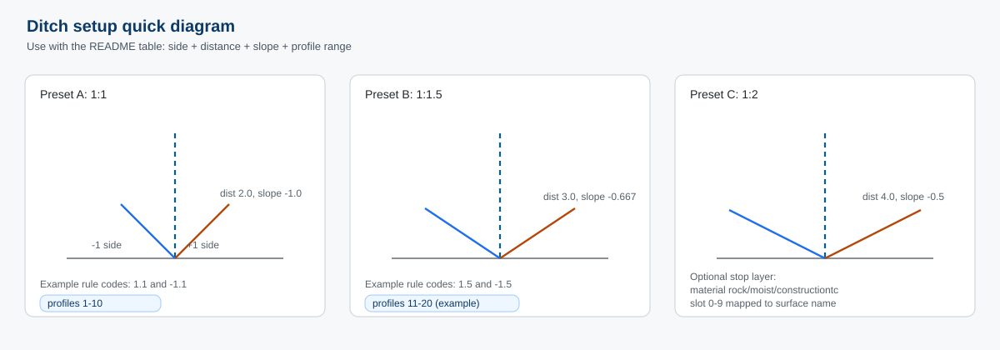
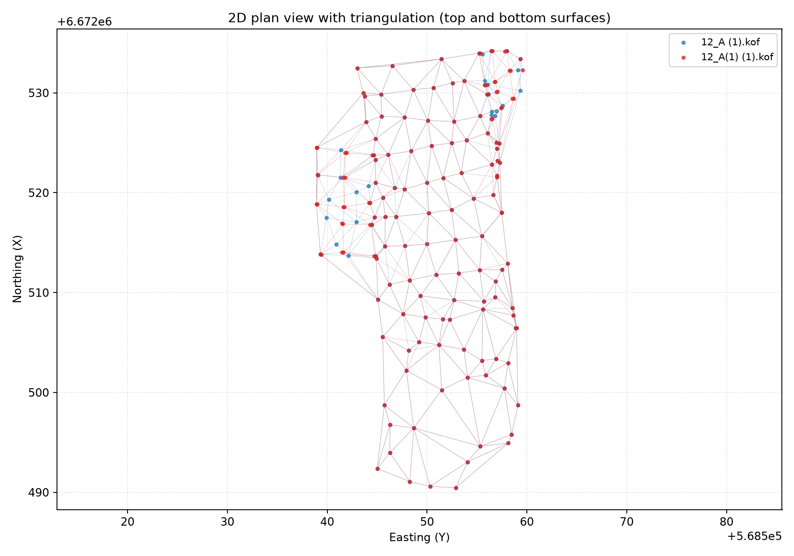
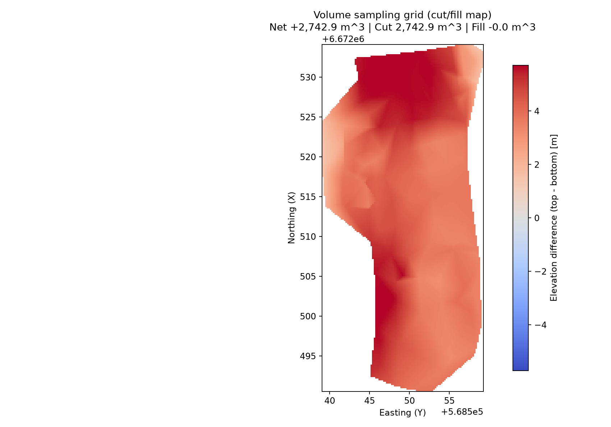
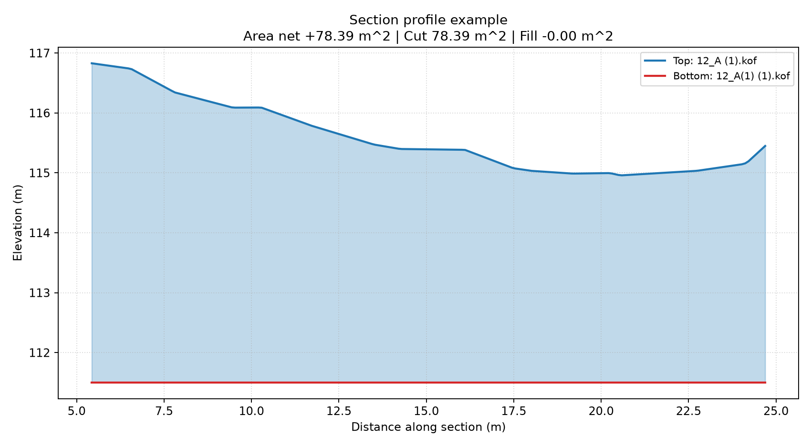

# KOFvision

KOFvision is a standalone Python viewer for KOF/SOSI/LandXML survey surfaces with:

- 2D and 3D visualization
- KOF polyline parsing (`09 91` ... `09 99` / `09 96`)
- surface triangulation (Delaunay)
- cut/fill volume calculation between two surfaces
- interactive section drawing and profile charts

The main app is implemented in `kof_viewer.py`.

## Features

- Open one or more `.kof`, `.sos`/`.sosi`, or `.xml` (LandXML) files
- Plot points/polylines in 2D plan view
- Plot points/polylines in 3D with optional triangulated surface
- Toggle labels, markers, lines, triangulation, and equal aspect mode
- Load a georeferenced orthophoto/raster background in the 2D tab
- Configure an optional WMS background for the 2D tab
- Toggle file layers and raster layer from the Layers panel
- Zoom 2D view to selected (visible) layers
- Select top and bottom surfaces and compute:
	- net volume
	- cut volume
	- fill volume
	- overlap area
	- volume source modes:
		- `Selected surfaces` (default): independently choose KOF, LandXML, or elevation raster for Top and Bottom
		- legacy active-raster modes remain available:
		- `Top surface - Bottom surface`
		- `Top surface - Raster`
		- `Raster - Bottom surface`
		- `Raster - Top surface`
- Optional intermediate layer for split-volume calculation:
	- KOF, SOSI, or LandXML layer
	- raster elevation layer
	- virtual constant Z plane
	- split output:
		- Top - Intermediate
		- Intermediate - Bottom
		- Total (sum of both legs)
- Load multiple raster layers, reorder them (up/down), toggle visibility, and set per-layer alpha
- Refresh WMS maps asynchronously while panning or zooming the 2D view
- Use any loaded single-band elevation raster as Top, Bottom, or Intermediate with either volume method
- Set an active elevation raster for legacy raster source modes and the section reference profile
- Optionally clip raster loading to current KOF bounds with user-defined buffer
- Modern hybrid UI: slim top command bar + collapsible right-side analysis panels
- Scrollable right-side panel column for smaller screen heights
- Draw one or more section lines in 2D and open section windows with:
	- top and bottom profiles
	- optional active raster reference profile
	- shaded cut/fill regions
	- net/cut/fill cross-section area
- Draw one or more ditch centerlines in 2D and use them as section-report baselines
- Configure ditch rules with side, distance, slope, profile range, and optional stop-layer constraints
- Save and load polygon masks as JSON
- Save and load section lines as JSON
- Save and load ditch centerlines/rules in project files
- Export a section-report package:
	- profile images at fixed spacing along a baseline (for example every 1 m)
	- plan-view image with baseline and profile numbers
	- HTML report and JSON manifest
- Export loaded vector surfaces to GeoPackage:
	- KOF/SOSI source points + original polylines
	- LandXML source points + TIN triangles

## Requirements

- Python 3.10+
- `numpy`
- `matplotlib`
- `scipy`
- `tkinter` (usually included with standard Python installers)

Install Python dependencies:

```bash
pip install numpy matplotlib scipy
```

Optional (required only for GeoPackage export from the viewer):

```bash
pip install geopandas shapely
```

Optional (for enhanced button styling in the top command bar):

```bash
pip install customtkinter
```

If CustomTkinter is not installed, KOFvision automatically falls back to standard ttk widgets.

Development/testing dependencies:

```bash
pip install -r requirements-dev.txt
```

## Run

Start empty and load files from the UI:

```bash
python kof_viewer.py
```

Or preload one or more KOF files:

```bash
python kof_viewer.py "12_A (1).kof" "12_A(1) (1).kof"
```

## UI Layout (Current)

KOFvision now uses a hybrid layout aimed at faster access to common actions and cleaner advanced settings:

- Top command bar:
	- Open
	- Export GPKG
	- Clear
	- Zoom to selected
	- Reset view
	- Compute volume
	- Draw section
	- Draw ditch
	- Draw mask
- Left panel:
	- Layer visibility (KOF, LandXML, and raster layers)
- Center:
	- 2D and 3D tabs
- Right panel (scrollable):
	- Display
	- Raster
	- Volume setup
	- Sections and mask
	- LandXML schema

The right panel supports collapse/expand per section and vertical scrolling for smaller screens.

### WMS background

In the Raster panel, choose **Configure WMS background...** and enter the WMS GetMap service URL, layer name, and CRS used by the loaded map coordinates (for example, `EPSG:25832`). KOFvision requests a transparent PNG map image for the current 2D extent and updates it when the view is panned or zoomed. WMS configuration is session-only and is not saved in project files.

## Keyboard Shortcuts

- Ctrl+O: Open files
- Ctrl+E: Export GPKG
- Ctrl+Shift+K: Clear loaded data
- Ctrl+Shift+Z: Zoom to selected visible layers
- Ctrl+Shift+R: Reset 2D view
- Ctrl+Shift+V: Compute volume
- Ctrl+Shift+S: Toggle Draw section mode
- Ctrl+Shift+L: Toggle Draw ditch mode
- Ctrl+Shift+M: Toggle Draw mask mode

## Tests

Run automated regression tests:

```bash
python -m pytest -q
```

## Package for End Users (Windows)

Build a distributable app with PyInstaller:

```powershell
python -m pip install -r requirements-build.txt
.\scripts\build_pyinstaller.ps1
```

This produces a release folder and a shareable ZIP in `dist/`.

For full packaging and distribution details, see `docs/pyinstaller-windows.md`.

## Workflow

1. Open elevation sources (KOF/LandXML files and/or single-band elevation rasters).
2. In the right-side Volume setup panel, leave Volume from as `Selected surfaces` and select Top and Bottom independently. DEM choices are prefixed with `Raster:` and include the source path, so selection survives raster reordering and distinguishes identical filenames in different folders.
3. Choose volume Method (`raster` or `triangles`).
4. Optionally choose Intermediate (`None`, `KOF layer`, `Raster layer`, or `Constant Z`).
5. If Intermediate is `Constant Z`, type Z directly and optionally use +/- with configurable step.
6. If intermediate is set, volume is reported as two legs:
	- Top - Intermediate
	- Intermediate - Bottom
7. Optionally enable Triangulation.
8. Click Compute volume (top bar or in Volume setup panel).
9. Read net/cut/fill (or split results) in the Volume setup panel summary.
10. Click Draw section and pick two points in 2D to open a section profile window.

## Ditch Tool

The ditch workflow lets you define centerline-driven profile modifications before report volume integration.

### Quick Start

1. Click Draw ditch in the top bar (or press Ctrl+Shift+L).
2. Click two points in 2D to define a ditch centerline.
3. Open the Sections and mask panel and click Ditch setup....
4. Add one or more ditch rules and save.
5. Export section report. The selected ditch centerline is used as baseline.

### Rule Fields

- Code label: rule identifier (for example `1.1`, `-2.1`).
	- It is a label, not geometry by itself.
- Side:
	- `+1` = right side of centerline
	- `-1` = left side of centerline
- Dist (m): horizontal extension distance from previous branch point.
- Slope: applied along rule distance.
- Profile start / Profile end: profile index range where rule applies.
	- Profile indexing is 1-based (`P0001` is index 1).
- Stop material (optional): `rock`, `moist`, or `constructiontc`.
- Stop slot (optional): layer slot `0..9` for selected stop material.

### Layer Mapping (Stop Rules)

In Volume setup, assign surface names to material slots (project-level mapping):

- `rock[0..9]`
- `moist[0..9]`
- `constructiontc[0..9]`

These mappings are shared across ditch rules and pit stop-layer settings.
You can map both vector surfaces (KOF/LandXML) and loaded elevation rasters (`Raster: ...` entries).
If a rule has a stop material/slot and mapped surface, extension is clipped at that stop surface.

### Chained Surfaces

Multiple ditch rules on the same side are chained in order.

- First rule starts from centerline elevation.
- Next rule starts from where previous rule ended.

This supports multi-step ditch shapes (for example first leg then second leg).

### Profile Range Examples

- Rule set A for profiles 1-10.
- Rule set B for profiles 11-20.

Use separate rules with different profile ranges to switch geometry by profile segment.

### Ditch Setup Cheat Sheet

Use this compact table as a quick preset reference when filling in Ditch setup.



Figure: Centerline-based presets for common side slopes (1:1, 1:1.5, 1:2) and profile-range usage.

| Shape target | Side | Dist (m) | Slope | Profile start-end | Code label example | Notes |
|---|---:|---:|---:|---:|---|---|
| 1:1 side slope | `+1` | `2.0` | `-1.0` | `1-10` | `1.1` | Right side branch, drops 1 m per 1 m horizontal |
| 1:1 side slope | `-1` | `2.0` | `-1.0` | `1-10` | `-1.1` | Left side branch, mirrored |
| 1:1.5 side slope | `+1` | `3.0` | `-0.667` | `1-10` | `1.5` | Approx. 1 m down per 1.5 m horizontal |
| 1:1.5 side slope | `-1` | `3.0` | `-0.667` | `1-10` | `-1.5` | Left side mirror |
| 1:2 side slope | `+1` | `4.0` | `-0.5` | `1-10` | `2.1` | Approx. 1 m down per 2 m horizontal |
| 1:2 side slope | `-1` | `4.0` | `-0.5` | `1-10` | `-2.1` | Left side mirror |

Two-rule V-ditch example (both sides active):

| Code | Side | Dist (m) | Slope | Profiles |
|---|---:|---:|---:|---:|
| `1.1` | `+1` | `2.0` | `-1.0` | `1-10` |
| `-1.1` | `-1` | `2.0` | `-1.0` | `1-10` |

Optional stop-layer values for any row above:

- Stop material: `rock`, `moist`, or `constructiontc`
- Stop slot: `0..9` (must be mapped in Layer mapping)

## Volume Calculation Methods

KOFvision computes signed difference as:

- `difference = top_surface - bottom_surface`
- Positive difference contributes to `cut`
- Negative difference contributes to `fill`
- `net = cut - fill` (equivalently, signed integral of `difference`)

### Quick Method Comparison

| Method | Typical speed | Accuracy profile | Supported inputs | Intermediate split support |
|---|---|---|---|---|
| `raster` | Faster (default workflow) | Grid-approximation; accuracy depends on sampling resolution (`target_cells`) | Any pair of KOF, LandXML, DEM, or constant-Z surfaces | Yes (`KOF`, `LandXML`, `Raster`, `Constant Z`) |
| `triangles` | Slower | Exact polygon-overlap integration of the resulting piecewise-planar surfaces | Any pair of KOF, LandXML, DEM, or constant-Z surfaces | Yes (`KOF`, `LandXML`, `Raster`, `Constant Z`) |

### 1) `raster` method (default)

Used by `compute_volume(..., method="raster")`.

How it works:

1. Finds XY overlap of top and bottom surface bounds.
2. Builds a regular sampling grid over overlap (resolution from `target_cells`, default ~200 across max span).
3. Interpolates top and bottom elevations at cell centers.
4. Optionally applies polygon mask (only samples inside mask are counted).
5. Integrates with:
	- `net = sum(diff) * cell_area`
	- `cut = sum(diff where diff>0) * cell_area`
	- `fill = -sum(diff where diff<0) * cell_area`

Supports:

- Any combination of KOF, LandXML, and elevation raster surfaces, including DEM vs DEM
- Vector surfaces are sampled directly onto the calculation grid; no intermediate raster file is needed
- Split-volume with intermediate layer (`KOF`, `LandXML`, `Raster`, `Constant Z`)

### 2) `triangles` method

Used by `compute_volume(..., method="triangles")`.

How it works:

1. Uses each source's triangles: KOF Delaunay with boundary filtering, LandXML TIN faces, or two triangles per valid DEM grid quad. Constant-Z planes use two triangles over their bounds.
2. Finds overlapping top/bottom triangle pairs by bounding-box prefilter.
3. Computes exact convex polygon intersections for candidate pairs.
4. Integrates linear surface difference analytically over each overlap polygon.
5. Splits positive and negative contributions into cut/fill.

This method integrates the resulting triangles exactly, and is usually slower than `raster`.

Supports:

- Any combination of KOF, LandXML, elevation raster, and constant-Z surfaces
- Split-volume with any of those intermediate surfaces
- Polygon masks and union mask scopes without switching to the raster method

DEM conversion details and limitations:

- Triangles use the same sample coordinates and row orientation as the existing DEM interpolator.
- A quad is excluded if any of its four samples is non-finite (NaN/infinity); holes are not bridged by Delaunay triangulation.
- DEM triangles are piecewise planar. They can differ from bilinear raster interpolation on non-planar quads, so the two methods need not produce identical cut/fill results.
- Orthophotos/RGB rasters are display-only and are not elevation inputs.
- Theoretical pit surfaces still require the raster method.
- For sloped pits, the 2D plan map draws a dedicated pit slope-end line (daylight line) for each visible pit.
  If the side slope is very shallow, KOFvision automatically expands the search area so the outer daylight line is still found and shown.
- Large-raster loading, clipping, and mesh scalability are unchanged.

### Intermediate Split-Volume

When `Intermediate` is set, either method computes two legs:

- `upper = Top - Intermediate`
- `lower = Intermediate - Bottom`

The UI reports both leg nets and total net. Intermediate must be different from top and bottom.

### Boundary Tightness

Boundary tightness filters long triangulation edges (relative to median edge length) before interpolation/integration.

- Lower values: tighter boundary, more outer triangles removed.
- Higher values: looser boundary, more outer triangles retained.

Changing boundary tightness marks previous volume results as stale; recompute volume after adjustment.

## Mask And Section Persistence

- Draw mask: create polygon by left-clicking vertices in 2D, close with right-click or double-click.
- Save mask...: write the current closed mask polygon to JSON.
- Load mask...: restore a previously saved mask polygon from JSON.
- Draw section: create section lines in 2D.
- Save sections...: store all currently drawn section lines as JSON.
- Load sections...: restore section lines from JSON.

## Section Report Export

Use Export section report... in the right-side Sections and mask panel.

Current behavior:

1. Uses the selected ditch centerline as report baseline when available.
   - If no ditch centerline exists, falls back to latest section line.
2. Prompts for:
	- profile spacing in meters (for example 1.0)
	- cross-section length in meters
	- number of interpolation samples per profile
	- output folder
3. Creates one timestamped output folder containing:
	- `plan_view.png`
	- `profiles/P0001.png`, `profiles/P0002.png`, ...
	- `report.html`
	- `report_manifest.json`

The report metadata/manifest also includes active ditch rule configuration and stop-layer hits.

The HTML report includes plan view, profile summary table, and all profile images with profile IDs and station distances.

### Section Plot Legend And Styles

Lines:

- Top surface: solid blue line
- Bottom surface: solid red line
- Raster reference (when active): dashed green line
- Intermediate layer (when selected): dotted orange line

Shading:

- Without intermediate: cut/fill area between top and bottom is shaded by sign.
- With intermediate selected: section is split into two colored legs:
	- Upper leg (Top - Intermediate): blue-toned fill
	- Lower leg (Intermediate - Bottom): orange-toned fill

This legend applies to both interactive section windows and exported section report profile images.

### View Controls

- Zoom to selected layers: fit the 2D view to visible layers.
- Reset view: clear manual zoom and return to auto extents.
- Both controls are available on the top command bar.

## Raster Background (Orthophoto)

The 2D tab can display a raster image as background (for example orthophoto)
behind KOF points and polylines.

Use the right-side Raster panel:

- Open raster...: load raster image (`.jpg`, `.jpeg`, `.png`, `.tif`, `.tiff`, `.bmp`)
- Set elevation raster: mark one loaded single-band DEM raster for raster-based volume modes
- Raster up / Raster down: reorder raster draw order
- Remove raster: remove the active raster layer
- Raster alpha: control transparency

Additional behavior:

- Multiple rasters can be loaded simultaneously.
- Elevation-based volume modes require a supported single-band elevation raster.
- Non-elevation rasters can still be shown in 2D as visual background.

Raster visibility is controlled in the left Layers panel, where raster appears
as its own layer entry.

### Georeferencing Requirements

Raster placement uses a world file next to the image. Supported world-file naming:

- `.jgw`, `.jpgw`, `.jpegw` for JPEG
- `.pgw`, `.pngw` for PNG
- `.tfw`, `.tifw`, `.tiffw` for TIFF
- `.bpw`, `.bmpw` for BMP
- `.wld` fallback

Notes:

- Raster and KOF data must be in the same projected CRS for proper alignment.
- Rotated world files (non-zero rotation terms) are currently not supported.
- Very large rasters are automatically loaded as a downsampled preview for
	faster display; georeferencing still uses full-resolution world-file metadata.

## Example Images

These images are generated from the included sample files:

- `12_A (1).kof`
- `12_A(1) (1).kof`

### 2D Plan + Triangulation



### Volume Sampling (Cut/Fill Map)



### Section Profile Example



## Regenerate README Images

A helper script is included to regenerate the images:

```bash
python scripts/generate_readme_images.py
```

It writes PNG files to `docs/images/`.

## Notes

- Coordinates are interpreted as:
	- `X` = Northing
	- `Y` = Easting
	- `H` = Elevation
- Volume method options:
	- `raster` (default): grid sampling over overlap between selected vector surfaces and/or elevation rasters.
	- `triangles`: direct polygon-overlap integration on vector TINs and/or triangulated elevation rasters.
	- split-volume with KOF, LandXML, raster, or constant-Z intermediate layers is available with either method.
- Interpolation outside the filtered triangulation boundary is ignored.
