# KOFvision Architecture Diagram

This diagram shows the current high-level module structure around `kof_viewer.py` and the major runtime data/compute flows.

```mermaid
flowchart TB
    U[User interactions<br/>toolbar, panels, shortcuts, canvas] --> KV[kof_viewer.py<br/>Coordinator + Tk root]

    KV --> UI[viewer_ui.py<br/>theme + panel widgets]
    KV --> TOOLS[viewer_tools.py<br/>section/ditch/mask/pit/measure/note tools]
    KV --> STATE[viewer_state.py<br/>reset + state transitions]
    KV --> SER[viewer_serialization.py<br/>project payload save/load + migration]
    KV --> RASTER_MGR[raster_management.py<br/>raster stack + elevation raster selection]
    KV --> RENDER[viewer_rendering.py<br/>2D/3D drawing passes]
    KV --> UNDO[viewer_undo.py<br/>snapshot undo/redo]
    KV --> EXEC[task_executor.py<br/>background jobs + UI callbacks]
    KV --> VCTRL[volume_controller.py<br/>volume orchestration]
    KV --> PREF[preferences.py<br/>persisted local settings]

    TOOLS --> KV
    STATE --> KV
    SER --> KV
    RASTER_MGR --> KV
    RENDER --> KV
    UNDO --> KV
    PREF --> KV

    KV --> DOMAIN[Domain layer]
    subgraph Domain layer
      PARSERS[parser.py / sosi_import.py / landxml_parser.py]
      MODELS[models.py<br/>KOFFile, VectorSurface, LandXMLSurface]
      RASTER[raster.py / wms.py]
      VOL[volume.py]
      DITCH[ditch.py]
      PIT[pit.py]
      REPORT[report_service.py / section_report.py / report_templates.py]
      EXPORT[export.py]
      MASK_IO[mask_io.py / sections_io.py]
      GEOM[geometry.py]
    end

    VCTRL --> VOL
    VCTRL --> DITCH
    VCTRL --> PIT
    KV --> PARSERS
    KV --> MODELS
    KV --> RASTER
    KV --> REPORT
    KV --> EXPORT
    KV --> MASK_IO
    KV --> GEOM

    SER --> DITCH
    SER --> PIT
    SER --> MASK_IO

    REPORT --> VOL
    REPORT --> DITCH
    REPORT --> PIT
```

## Notes

- The coordinator remains the composition root: UI events are bound there, then delegated to focused modules.
- Most computational features (volume, ditch, pit, sections, reports) are format-agnostic because imported sources are normalized to shared surface abstractions.
- Background execution is isolated in `task_executor.py`; UI mutations are marshaled back to the Tk thread through coordinator callbacks.
